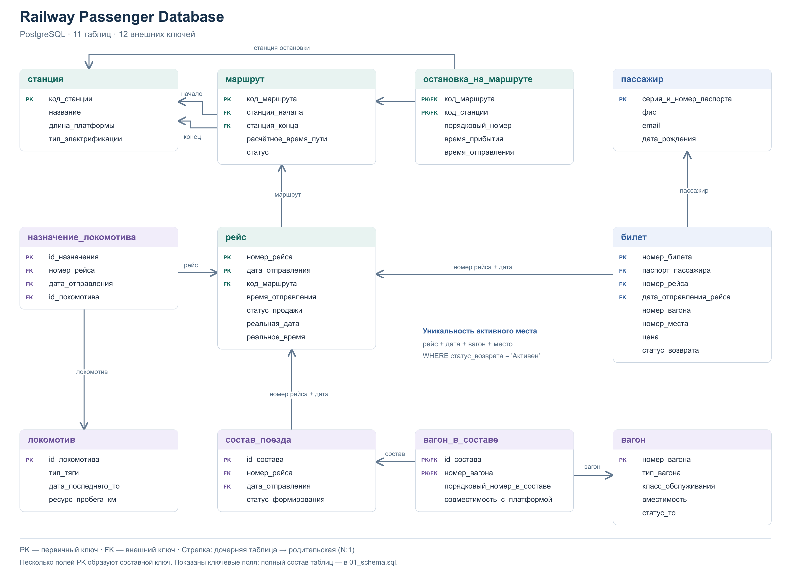

# Railway Passenger Database

Реляционная база данных пассажирских железнодорожных перевозок:
маршруты, рейсы, пассажиры, билеты и подвижной состав.
Проект объединяет моделирование данных, ограничения целостности
и аналитические SQL-запросы в PostgreSQL.

## Инструменты

PostgreSQL · SQL · pgAdmin · Database Design · Data Modeling

## Задача проекта

Спроектировать связанную модель для планирования рейсов, учёта билетов
и назначения подвижного состава, а затем использовать её для анализа
продаж, возвратов, задержек и готовности вагонов.

- Маршрутная сеть: станции, направления и последовательность остановок.
- Расписание: рейсы с отдельной идентификацией каждого отправления.
- Билеты: связь с пассажиром и рейсом, цена, место и статус возврата.
- Подвижной состав: вагоны, составы поездов и назначения локомотивов.

## Основные результаты

| Компонент | Результат |
| --- | ---: |
| Связанные таблицы | 11 |
| Внешние ключи, включая составные | 12 |
| Записи в демонстрационном наборе | 47 |
| Аналитические запросы | 7 |

Проверены создание базы с нуля, загрузка данных, создание индексов
и выполнение всех запросов на PostgreSQL 18.6.
Отдельная проверка подтверждает повторную продажу места после возврата
и запрет двух активных билетов на одно место одного рейса.

## Схема базы данных



Показаны ключевые поля и все внешние ключи. Стрелки направлены
от дочерней таблицы к родительской. Полный состав таблиц —
в [01_schema.sql](sql/01_schema.sql), редактируемая схема —
в [SVG](images/database_schema.svg).

## Модель данных

| Таблица | Назначение |
| --- | --- |
| `станция` | Станции, параметры платформ и электрификации |
| `маршрут` | Начальная и конечная станции, время пути, статус маршрута |
| `остановка_на_маршруте` | Порядок остановок, время прибытия и отправления |
| `рейс` | Конкретное отправление, маршрут, плановые и фактические дата и время |
| `пассажир` | Данные пассажиров |
| `билет` | Пассажир, рейс, вагон, место, цена и статус возврата |
| `вагон` | Тип, класс обслуживания, вместимость и статус ТО |
| `локомотив` | Тип тяги, мощность и сведения о техническом обслуживании |
| `состав_поезда` | Состав, привязанный к рейсу |
| `вагон_в_составе` | Вагоны состава и их порядковые номера |
| `назначение_локомотива` | Назначение локомотива на рейс |

## Бизнес-правила и целостность

| Правило | Реализация |
| --- | --- |
| Рейс определяется номером и датой отправления | Составной `PRIMARY KEY` |
| Билет, состав и назначение локомотива ссылаются на конкретное отправление | Составные `FOREIGN KEY` |
| Одно место одного рейса может иметь только один активный билет | Частичный уникальный индекс `unique_active_place` |
| Цена билета не может быть отрицательной | `NOT NULL` и `CHECK (цена >= 0)` |
| Фактические дата и время либо заполнены вместе, либо оба отсутствуют | `CHECK` для пары полей |
| Обязательные статусы маршрутов, билетов и вагонов имеют допустимые значения | `NOT NULL`, `CHECK` и значения по умолчанию |

Возвращённый билет сохраняется в истории и освобождает место для повторной
продажи. У конечной остановки время отправления может отсутствовать;
длительность стоянки вычисляется из времени прибытия и отправления.

## Бизнес-вопросы

В [04_business_queries.sql](sql/04_business_queries.sql) подготовлены семь запросов:

1. Какие маршруты дают наибольшую сумму по активным билетам?
2. Сколько билетов оформлено на каждый рейс и какая доля возвращена?
3. У каких рейсов фактические дата и время позже плановых?
4. Какие пассажиры имеют наибольшую сумму активных билетов?
5. Каковы средняя стоимость и диапазон цен билетов по маршрутам?
6. Какие типы вагонов назначены в составы и есть ли неготовые вагоны?
7. Как распределены покупки по датам с учётом текущего статуса билетов?

### Сумма активных билетов по маршрутам

`LEFT JOIN` сохраняет маршруты без продаж. Возвращённые билеты
исключены из суммы.

```sql
SELECT
    м.код_маршрута,
    COUNT(б.номер_билета) AS активных_билетов,
    COALESCE(SUM(б.цена), 0) AS сумма_активных_билетов
FROM маршрут AS м
LEFT JOIN рейс AS р
    ON р.код_маршрута = м.код_маршрута
LEFT JOIN билет AS б
    ON б.номер_рейса = р.номер_рейса
    AND б.дата_отправления_рейса = р.дата_отправления
    AND б.статус_возврата = 'Активен'
GROUP BY м.код_маршрута
ORDER BY сумма_активных_билетов DESC, м.код_маршрута;
```

### Рейтинг пассажиров

CTE агрегирует активные билеты каждого пассажира.
`DENSE_RANK` присваивает одинаковое место при равных суммах.

```sql
WITH суммы_пассажиров AS (
    SELECT
        паспорт_пассажира,
        COUNT(*) AS активных_билетов,
        SUM(цена) AS сумма_активных_билетов
    FROM билет
    WHERE статус_возврата = 'Активен'
    GROUP BY паспорт_пассажира
)
SELECT
    DENSE_RANK() OVER (
        ORDER BY с.сумма_активных_билетов DESC
    ) AS место_в_рейтинге,
    п.фио,
    с.активных_билетов,
    с.сумма_активных_билетов
FROM суммы_пассажиров AS с
JOIN пассажир AS п
    ON п.серия_и_номер_паспорта = с.паспорт_пассажира
ORDER BY место_в_рейтинге, п.фио, с.паспорт_пассажира;
```

### Результаты на демонстрационных данных

| Проверка | Результат |
| --- | --- |
| Сумма активных билетов Москва — Сочи | 9 000,00 |
| Сумма активных билетов Москва — Санкт-Петербург | 6 200,00 |
| Доля возвратов на рейсе 100 от 01.06.2026 | 33,33%: 1 из 3 билетов |
| Отклонение фактического времени рейса 100 от 01.06.2026 | +45 минут |
| Назначения вагонов со статусом ТО, отличным от «Готов» | 1 |

Это результаты проверки SQL на небольшом наборе данных;
они не описывают показатели реального перевозчика.

## Индексы

В [03_indexes.sql](sql/03_indexes.sql) сохранены 15 индексов исходного проекта:
для поиска маршрутов по станциям, фильтрации рейсов по дате,
обращений к билетам по пассажиру и рейсу, а также связей с подвижным составом.

Первичные ключи уже создают индексы автоматически. Некоторые дополнительные
индексы перекрываются с индексами ключей; набор сохранён для соответствия
исходной реализации. Замеры ускорения на больших данных не проводились.
Индекс `unique_active_place` включён в файл схемы как правило целостности.

## Данные и ограничения

Модель и исходные SQL восстановлены из университетского проекта.
Демонстрационный набор содержит 4 станции, 4 маршрута, 4 рейса,
4 пассажира и 4 билета, а также записи о подвижном составе.

- Набор предназначен для проверки связей, ограничений и запросов;
  его объёма недостаточно для выводов о спросе и сезонности.
- Сумма активных билетов рассчитывается по текущему статусу.
  Даты возвратов, комиссии и суммы фактических возмещений не хранятся.
- Автоматический расчёт тарифа, блокировка места по таймеру и запрет
  изменения маршрута после назначения рейсов не реализованы.
- Билет хранит порядковый номер вагона, но не имеет внешнего ключа
  на вагон в составе. Назначения вагонов заполнены для одного состава;
  процент загрузки рейсов не рассчитывается.
- Длительности и время остановок используют `TIME`.
  Маршруты продолжительностью более суток требуют доработки модели.

## Структура проекта

Основные файлы репозитория:

```text
railway-passenger-database/
├── README.md
├── images/
│   ├── database_schema.png
│   └── database_schema.svg
└── sql/
    ├── 01_schema.sql
    ├── 02_seed_data.sql
    ├── 03_indexes.sql
    ├── 04_business_queries.sql
    ├── migrations/
    │   └── 01_active_ticket_seats.sql
    └── tests/
        └── 01_active_ticket_seats.sql
```

## Запуск

Требуются запущенный PostgreSQL 18 и утилиты `createdb` и `psql`,
доступные в терминале. Для macOS подходит
[Postgres.app](https://postgresapp.com/documentation/install.html).
База должна использовать кодировку UTF-8.

Из основной папки проекта создайте **новую пустую базу**
и выполните файлы по порядку:

```bash
createdb -h localhost railway_db

psql -X -h localhost -v ON_ERROR_STOP=1 --single-transaction \
    -d railway_db -f sql/01_schema.sql
psql -X -h localhost -v ON_ERROR_STOP=1 --single-transaction \
    -d railway_db -f sql/02_seed_data.sql
psql -X -h localhost -v ON_ERROR_STOP=1 --single-transaction \
    -d railway_db -f sql/03_indexes.sql
psql -X -h localhost -v ON_ERROR_STOP=1 \
    -d railway_db -f sql/04_business_queries.sql
```

Команды используют стандартный порт 5432 и роль с именем пользователя ОС.
Если роль другая, добавьте `-U имя_роли` к каждой команде.
`ON_ERROR_STOP` останавливает выполнение файла при ошибке;
`--single-transaction` отменяет изменения этого файла, если он не выполнится целиком.
Схема и данные предназначены для однократной загрузки.

В pgAdmin создайте базу с настройками локали, совпадающими с шаблоном,
и выполните те же четыре файла по порядку через Query Tool этой базы.
Для отдельных запросов открывайте новую вкладку, чтобы сохранить исходные файлы.

### Проверка повторной продажи места

```bash
psql -X -h localhost -v ON_ERROR_STOP=1 \
    -d railway_db -f sql/tests/01_active_ticket_seats.sql
```

Проверка выводит два сообщения `OK` и заканчивается `ROLLBACK`:
тестовые билеты не сохраняются. Файл в `sql/migrations/` нужен только для базы,
созданной с прежним ограничением `unique_place`; при новом запуске он не требуется.

## Навыки

Реляционное моделирование, составные ключи, ссылочная целостность,
ограничения `CHECK`, частичные уникальные индексы, агрегирование,
`JOIN`, `FILTER`, `CASE`, CTE и оконные функции.
